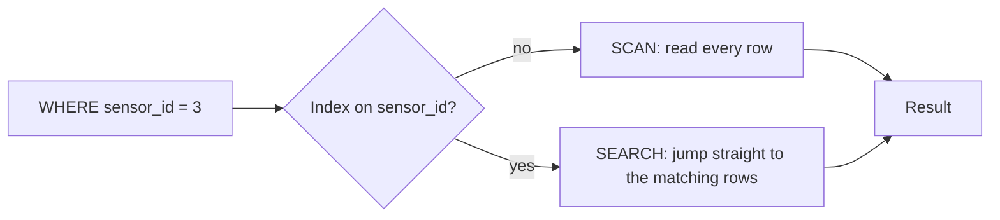

{:class="cover"}

---

By the end of this lesson you will be able to save a query as a view, create an index, and use `EXPLAIN QUERY PLAN` to check that a query uses it.

---

Two tools make a database nicer to live with. A **view** saves a query so you don't retype it. An **index** makes searches faster. Neither changes your data.

## Views: a saved query

In lesson 9 we counted sensors per robot with a join and a `GROUP BY`. That is a lot to type each time. Save it with `CREATE VIEW`:

```sql
CREATE VIEW robot_sensor_summary AS
SELECT r.robot_id,
       r.name AS robot,
       COUNT(s.sensor_id) AS sensors_fitted,
       ROUND(COALESCE(SUM(s.price), 0), 2) AS sensor_cost
FROM robots AS r
LEFT JOIN sensors AS s ON s.robot_id = r.robot_id
GROUP BY r.robot_id;
```

(`COALESCE` swaps a `NULL` for a fallback value, here 0. Lesson 14 covers it.) The view behaves like a read-only table you can query:

```sql
SELECT * FROM robot_sensor_summary ORDER BY robot_id;
```

```text
robot_id  robot        sensors_fitted  sensor_cost
--------  -----------  --------------  -----------
1         Smars        2               3.7
2         Pico Walker  2               6.3
3         Arm Buddy    0               0.0
4         Line Chaser  2               2.4
5         Mystery Bot  0               0.0
```

You can filter and sort it like any table:

```sql
SELECT robot, sensor_cost FROM robot_sensor_summary
WHERE sensors_fitted > 0
ORDER BY sensor_cost DESC;
```

A view stores the **query**, not the results. Every time you use it, the query runs afresh, so it always shows current data. Change a sensor price, and the view reflects it straight away.

Views are handy for three reasons: they save typing, they hide complicated joins behind a friendly name, and they let you give someone a limited window onto the data. In SQLite you can't insert into or update a view:

```sql
INSERT INTO robot_sensor_summary VALUES (9, 'x', 0, 0);
```

```text
cannot modify robot_sensor_summary because it is a view
```

Remove a view with `DROP VIEW robot_sensor_summary;`. The tables underneath are untouched. To change a view, drop it and create it again.

## Indexes: a book's index for your table

Without an index, finding all readings from sensor 3 means reading **every row** and checking each one. An **index** is a separate, sorted list of one column's values, with pointers to the rows, like the index at the back of a book.



Create one on the column you search by:

```sql
CREATE INDEX idx_readings_sensor ON readings (sensor_id);
```

### Checking that it is used

Put `EXPLAIN QUERY PLAN` in front of a query and SQLite tells you its plan instead of running it. Before the index existed it said:

```text
QUERY PLAN
`--SCAN readings
```

Now run it with the index in place:

```sql
EXPLAIN QUERY PLAN SELECT * FROM readings WHERE sensor_id = 3;
```

```text
QUERY PLAN
`--SEARCH readings USING INDEX idx_readings_sensor (sensor_id=?)
```

`SCAN` means "read the whole table" and `SEARCH ... USING INDEX` means "jump straight to the matching rows". The exact wording and layout differs a little between SQLite versions (older ones say `SCAN TABLE readings`), and the `sqlite3` tool and Python show the plan in slightly different shapes, but the SCAN or SEARCH idea is the same.

An index only helps the column it covers. A search on `value` still scans:

```sql
EXPLAIN QUERY PLAN SELECT * FROM readings WHERE value > 20;
```

Columns marked `UNIQUE` or `PRIMARY KEY` get an index automatically. List the views and indexes in your database:

```sql
SELECT type, name FROM sqlite_master
WHERE type IN ('view', 'index')
ORDER BY type, name;
```

```text
type   name
-----  ---------------------------
index  idx_readings_sensor
index  sqlite_autoindex_bookings_1
index  sqlite_autoindex_build_parts_1
index  sqlite_autoindex_builders_1
index  sqlite_autoindex_mentors_1
index  sqlite_autoindex_parts_1
index  sqlite_autoindex_robots_1
index  sqlite_autoindex_tool_sessions_1
view   robot_sensor_summary
```

Those `sqlite_autoindex_` entries are the automatic ones, made for `UNIQUE` columns and composite primary keys.

### More than one column

An index can cover two columns. This one speeds up "one sensor's readings after a certain time":

```sql
CREATE INDEX idx_readings_sensor_time ON readings (sensor_id, taken_at);
```

Order matters: it helps searches on `sensor_id` alone, or `sensor_id` and `taken_at` together, but not `taken_at` alone. Drop an index you don't need with `DROP INDEX idx_readings_sensor_time;`.

## The price of an index

Indexes aren't free. Each one takes disk space, and every `INSERT`, `UPDATE` and `DELETE` must keep it up to date, which slows writing slightly. Index the columns you search and join on a lot, not everything.

With 10 readings you won't notice any speed difference. To see a real one, save this program as `index_demo.py` and run it with `python3 index_demo.py`. It builds a throwaway in-memory database with 200,000 fake readings and times 200 lookups before and after adding an index:

```python
import random
import sqlite3
import time

# Build a throwaway in-memory database with 200,000 fake readings.
db = sqlite3.connect(":memory:")
db.execute("CREATE TABLE readings (reading_id INTEGER PRIMARY KEY, sensor_id INTEGER, value REAL)")
rows = [(random.randint(1, 1000), random.random() * 100) for _ in range(200_000)]
db.executemany("INSERT INTO readings (sensor_id, value) VALUES (?, ?)", rows)
db.commit()


def time_lookups(label):
    start = time.perf_counter()
    for sensor in range(1, 201):
        db.execute("SELECT COUNT(*), AVG(value) FROM readings WHERE sensor_id = ?", (sensor,)).fetchone()
    elapsed = time.perf_counter() - start
    print(f"{label}: {elapsed:.3f} seconds for 200 lookups")


time_lookups("Without an index")
db.execute("CREATE INDEX idx_readings_sensor ON readings (sensor_id)")
time_lookups("With an index   ")
```

The times depend on your computer, but the indexed run should be many times faster. On the machine we tested, it took about 1.5 seconds without the index and about 0.02 seconds with it.

> **Teachers**: the timing demo runs on any computer with Python 3 in a few seconds, and makes a good class experiment: ask students to predict the speed-up before running it. Results vary on shared or slow machines, so compare ratios rather than exact times. A Raspberry Pi will be slower overall but shows the same pattern.

## Try it Yourself

1. Create a view called `distance_sensors` that lists `model`, `price` and the robot's `name` for every sensor of `kind = 'distance'` (use a `LEFT JOIN` so the spare sensor still appears). Query it.
2. Use `EXPLAIN QUERY PLAN` to check that looking up a robot by `name` uses an index. Why does it, though you never created one?
3. Challenge: change the `index_demo.py` program to search on `value` instead of `sensor_id`. Does the sensor index help? Create an index on `value` and compare.

## Common Issues

- **Problem**: `table robot_sensor_summary already exists` when creating a view.
- **Solution**: Use `DROP VIEW robot_sensor_summary;` first, or write `CREATE VIEW IF NOT EXISTS`.
- **Why**: Views and tables share the same namespace, so the name must be free.

- **Problem**: I added an index but the query is still a `SCAN`.
- **Solution**: Check that your `WHERE` is on the indexed column, and check for functions around it.
- **Why**: Wrapping a column in a function, as in `WHERE UPPER(name) = 'SMARS'`, stops a plain index being used. Compare the column directly where you can.

- **Problem**: `cannot modify ... because it is a view`.
- **Solution**: Change the underlying tables instead.
- **Why**: A view is a saved `SELECT`, not a table that holds rows.

## Check your understanding


? What does a view store?
- [ ] A copy of the query results
- [x] The query itself, which runs each time the view is used
- [ ] A sorted list of one column
> That's why a view always shows current data.

? What is the main benefit of an index?
- [ ] It makes `INSERT` faster
- [x] It lets the database find matching rows without reading the whole table
- [ ] It enforces foreign keys
> The trade-off is a little extra disk space and slightly slower writes.

? In `EXPLAIN QUERY PLAN` output, what does `SEARCH ... USING INDEX` tell you?
- [x] SQLite is using an index to jump to the matching rows
- [ ] SQLite is reading every row in the table
- [ ] The query failed
> `SCAN` is the one that reads the whole table.


One more tool for the toolbox: SQL's built-in functions.
