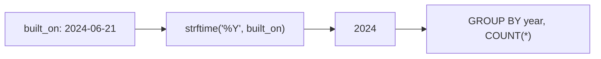

{:class="cover"}

---

By the end of this lesson you will be able to build labels from text, do arithmetic in a query, replace `NULL` with a fallback, and group robots by year using date functions.

---

A **function** takes a value, does something to it and hands back a new one. We already met `COUNT` and `AVG`. This lesson covers the everyday ones that work on each row. An **expression** is anything that produces a value: a column, a calculation, a function call, or a mixture.

These are SQLite's functions. Other databases have most of the same ideas under similar names, but not always the same spelling.

## Text functions

```sql
SELECT name, UPPER(name), LENGTH(name) FROM robots ORDER BY robot_id;
```

```text
name         UPPER(name)  LENGTH(name)
-----------  -----------  ------------
Smars        SMARS        5
Pico Walker  PICO WALKER  11
Arm Buddy    ARM BUDDY    9
Line Chaser  LINE CHASER  11
Mystery Bot  MYSTERY BOT  11
```

| Function | What it does | Example result |
|----------|--------------|----------------|
| `UPPER(x)`, `LOWER(x)` | Change case | `'smars'` becomes `'SMARS'` |
| `LENGTH(x)` | Number of characters | `LENGTH('Smars')` is 5 |
| `SUBSTR(x, start, len)` | Part of the text, counting from 1 | `SUBSTR('Smars', 1, 3)` is `Sma` |
| `REPLACE(x, old, new)` | Swap text | `REPLACE('Arm Buddy', ' ', '_')` is `Arm_Buddy` |
| `TRIM(x)` | Remove spaces at both ends | `TRIM('  hi ')` is `hi` |
| `INSTR(x, y)` | Position of `y` in `x`, or 0 | `INSTR('Pico Walker', ' ')` is 5 |
{:class="table table-single"}

Join pieces of text with the `||` operator to build a label:

```sql
SELECT name || ' (' || kind || ')' AS label FROM robots ORDER BY robot_id;
```

```text
label
--------------------
Smars (rover)
Pico Walker (walker)
Arm Buddy (arm)
Line Chaser (rover)
Mystery Bot (rover)
```

Handy for web-friendly names too: `REPLACE(LOWER(name), ' ', '_')` turns `Pico Walker` into `pico_walker`.

## NULL and COALESCE

Join text to a `NULL` and the whole result becomes `NULL`:

```sql
SELECT name || ' (' || battery_mah || ' mAh)' AS label FROM robots ORDER BY robot_id;
```

```text
label
----------------------
Smars (2000 mAh)
Pico Walker (1500 mAh)

Line Chaser (1200 mAh)

```

Arm Buddy and Mystery Bot come out blank. `COALESCE(x, fallback)` returns the first value that isn't `NULL`, which fixes it:

```sql
SELECT name, COALESCE(battery_mah, 0) AS battery FROM robots ORDER BY robot_id;
```

```text
name         battery
-----------  -------
Smars        2000
Pico Walker  1500
Arm Buddy    0
Line Chaser  1200
Mystery Bot  0
```

It works for text too:

```sql
SELECT name, COALESCE(built_on, 'not built yet') AS built FROM robots ORDER BY robot_id;
```

```text
name         built
-----------  -------------
Smars        2024-03-10
Pico Walker  2024-06-21
Arm Buddy    2024-09-02
Line Chaser  2025-01-15
Mystery Bot  not built yet
```

## Number functions and arithmetic

You can calculate right in the `SELECT`. How long would each battery last at a steady 500 mA draw?

```sql
SELECT name, battery_mah,
       ROUND(battery_mah / 500.0, 1) AS hours_at_500ma
FROM robots
WHERE battery_mah IS NOT NULL
ORDER BY robot_id;
```

```text
name         battery_mah  hours_at_500ma
-----------  -----------  --------------
Smars        2000         4.0
Pico Walker  1500         3.0
Line Chaser  1200         2.4
```

That is a rough estimate, because real draw changes as the robot moves. Note the `500.0`. Two whole numbers divide as whole numbers:

```sql
SELECT 7 / 2, 7 / 2.0, 7 % 2;
```

```text
7 / 2  7 / 2.0  7 % 2
-----  -------  -----
3      3.5      1
```

`ROUND(x, places)` rounds, `ABS(x)` drops the minus sign, and `%` gives the remainder. The `MAX(a, b, c)` and `MIN(a, b, c)` forms with several values compare them within one row, unlike the one-argument aggregates from lesson 9.

## Date functions

Dates stored as `YYYY-MM-DD` text can be handled by `date()`, `strftime()` and `julianday()`. Add days to a date, or find the end of a month:

```sql
SELECT date('2025-03-01', '+7 days'),
       date('2025-03-01', 'start of month', '+1 month', '-1 day');
```

```text
date('2025-03-01', '+7 days')  date('2025-03-01', 'start of month', '+1 month', '-1 day')
-----------------------------  ----------------------------------------------------------
2025-03-08                     2025-03-31
```

`strftime(format, date)` picks parts out of a date: `%Y` is the year, `%m` the month, `%d` the day, and `%H:%M` the hour and minute. Here is how many robots were built in each year:



```sql
SELECT strftime('%Y', built_on) AS year, COUNT(*) AS robots_built
FROM robots
WHERE built_on IS NOT NULL
GROUP BY year
ORDER BY year;
```

```text
year  robots_built
----  ------------
2024  3
2025  1
```

`julianday()` turns a date into a day count, so subtracting two gives the days between them. How old was each robot on 1 March 2025?

```sql
SELECT name,
       CAST(julianday('2025-03-01') - julianday(built_on) AS INTEGER) AS days_old
FROM robots
WHERE built_on IS NOT NULL
ORDER BY built_on;
```

```text
name         days_old
-----------  --------
Smars        356
Pico Walker  253
Arm Buddy    180
Line Chaser  45
```

`CAST(x AS INTEGER)` converts the value to a whole number. For today's date, use `date('now')`, which gives a different answer every day, so our examples use fixed dates.

## Formatting numbers

`printf` works like the format strings in many programming languages:

```sql
SELECT printf('%s: %.2f', model, price) FROM sensors WHERE sensor_id <= 2;
```

```text
printf('%s: %.2f', model, price)
--------------------------------
HC-SR04: 2.50
TCRT5000: 1.20
```

## Try it Yourself

1. Show each robot's name in lower case with spaces replaced by hyphens.
2. Show each sensor's `price` with 20 percent added, rounded to two places, under the heading `price_with_vat`.
3. Challenge: show each reading's time as `HH:MM` (using `strftime`) with its value, for sensor 1 only, in time order.

## Common Issues

- **Problem**: A label built with `||` is blank for some rows.
- **Solution**: Wrap the possibly-`NULL` column in `COALESCE(column, 'unknown')`.
- **Why**: Any text joined to `NULL` gives `NULL`.

- **Problem**: `7 / 2` gives 3, not 3.5.
- **Solution**: Make one number a decimal, `7 / 2.0`, or multiply by `1.0` first.
- **Why**: Dividing two integers gives a whole number in SQLite.

- **Problem**: `no such function: CONCAT` or `no such function: DATE_SUB`.
- **Solution**: Use `||` for joining text, and `date(x, '-7 days')` for date arithmetic. `CONCAT` exists in SQLite only from version 3.44.
- **Why**: Many tutorials show MySQL functions. SQLite has its own set, so check the SQLite function list when copying.

## Check your understanding


? What is the result of `7 / 2` in SQLite?
- [x] 3
- [ ] 3.5
- [ ] 4
> Two integers divide as integers. Use `7 / 2.0` to get 3.5.

? What does `COALESCE(battery_mah, 0)` return for a robot whose battery is `NULL`?
- [ ] `NULL`
- [x] 0
- [ ] An error
> `COALESCE` returns the first value that isn't `NULL`.

? Which function pulls the year out of a date such as `2024-06-21`?
- [ ] `YEAR(built_on)`
- [x] `strftime('%Y', built_on)`
- [ ] `SUBSTR(built_on, 1)`
> `strftime` with `%Y` gives the year as text. SQLite has no `YEAR()` function.


You now have every ingredient. Time to build something with them.
