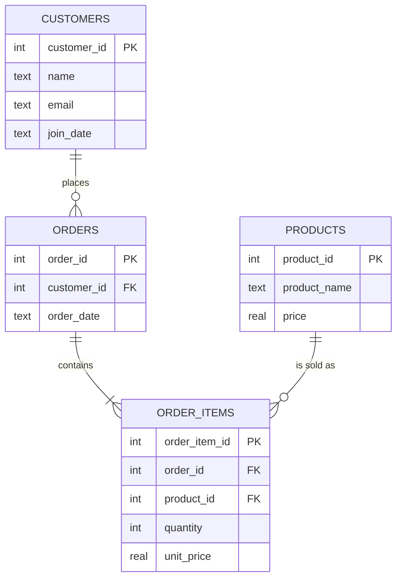

{:class="cover"}

---

By the end of this lesson you will have designed, filled and queried a four-table shop database on your own, using tables, constraints, joins, aggregates, a view and an index.

---

You've come a long way. You can create tables with rules, add and change data safely, ask questions with `SELECT`, join tables, summarise with `GROUP BY`, design with normal forms, and speed things up with views and indexes. Let's put all of it together in one project.

## The project: Maker Parts Shop

A friend runs a small online shop selling robot parts and wants a database to track customers, products and orders. We'll build it in a **new** database file so it doesn't mix with the workshop:

```bash
sqlite3 shop.db
```

{: .no-snakie }

(With the Python route, change `workshop.db` to `shop.db` in `sql_shell.py`.) Here is the design:



Notice the design choice in `order_items`: it stores the `unit_price` the customer actually paid. A product's price may change next month, but an old order must still show what was charged. It doesn't store a `total_price`, because we can calculate it (quantity times unit price) whenever we need it.

## Step 1: create the tables

```sql
PRAGMA foreign_keys = ON;

CREATE TABLE customers (
    customer_id INTEGER PRIMARY KEY,
    name        TEXT NOT NULL,
    email       TEXT NOT NULL UNIQUE,
    join_date   TEXT NOT NULL
);
CREATE TABLE products (
    product_id   INTEGER PRIMARY KEY,
    product_name TEXT NOT NULL UNIQUE,
    price        REAL NOT NULL CHECK (price >= 0)
);
CREATE TABLE orders (
    order_id    INTEGER PRIMARY KEY,
    customer_id INTEGER NOT NULL REFERENCES customers (customer_id),
    order_date  TEXT NOT NULL
);
CREATE TABLE order_items (
    order_item_id INTEGER PRIMARY KEY,
    order_id      INTEGER NOT NULL REFERENCES orders (order_id),
    product_id    INTEGER NOT NULL REFERENCES products (product_id),
    quantity      INTEGER NOT NULL CHECK (quantity > 0),
    unit_price    REAL NOT NULL
);
```

The `CHECK` rules refuse a negative price or a zero quantity. They are the same idea as `NOT NULL` and `UNIQUE`, but with a condition you write yourself.

## Step 2: add sample data

All of this is made up, so feel free to add your own rows afterwards.

```sql
INSERT INTO customers (name, email, join_date) VALUES
    ('Jo',    'jo@example.com',    '2024-02-11'),
    ('Sam',   'sam@example.com',   '2024-11-02'),
    ('Priya', 'priya@example.com', '2025-01-20'),
    ('Max',   'max@example.com',   '2025-02-14');
INSERT INTO products (product_name, price) VALUES
    ('Micro servo',       3.50),
    ('Ultrasonic sensor', 2.50),
    ('Pico board',        4.00),
    ('Motor driver',      6.00),
    ('Robot chassis kit', 55.00);
INSERT INTO orders (customer_id, order_date) VALUES
    (1, '2025-01-05'),
    (2, '2025-01-18'),
    (1, '2025-02-02'),
    (3, '2025-02-20');
INSERT INTO order_items (order_id, product_id, quantity, unit_price) VALUES
    (1, 5, 1, 55.00),
    (1, 4, 2,  6.00),
    (2, 1, 4,  3.50),
    (2, 3, 1,  4.00),
    (3, 2, 2,  2.50),
    (4, 1, 6,  3.50),
    (4, 3, 2,  4.00);
```

Try breaking a rule on purpose to see the guard rails work:

```sql
INSERT INTO order_items (order_id, product_id, quantity, unit_price) VALUES (1, 99, 1, 1.0);
INSERT INTO order_items (order_id, product_id, quantity, unit_price) VALUES (1, 1, 0, 3.5);
```

```text
FOREIGN KEY constraint failed
CHECK constraint failed: quantity > 0
```

## Step 3: answer the business questions

**Which customers joined in 2025?** Dates are text in `YYYY-MM-DD` form, so a simple comparison works. (Some tutorials use `DATE_SUB(NOW(), ...)`. That is MySQL and does not exist in SQLite.)

```sql
SELECT * FROM customers WHERE join_date >= '2025-01-01' ORDER BY join_date;
```

```text
customer_id  name   email              join_date
-----------  -----  -----------------  ----------
3            Priya  priya@example.com  2025-01-20
4            Max    max@example.com    2025-02-14
```

**How much of each product have we sold, and how much money did it bring in?**

```sql
SELECT p.product_name,
       SUM(oi.quantity) AS units_sold,
       SUM(oi.quantity * oi.unit_price) AS revenue
FROM order_items AS oi
JOIN products AS p ON p.product_id = oi.product_id
GROUP BY p.product_id
ORDER BY revenue DESC;
```

```text
product_name       units_sold  revenue
-----------------  ----------  -------
Robot chassis kit  1           55.0
Micro servo        10          35.0
Motor driver       2           12.0
Pico board         3           12.0
Ultrasonic sensor  2           5.0
```

**Which customers have placed more than one order?**

```sql
SELECT c.name, COUNT(o.order_id) AS orders_placed
FROM customers AS c
JOIN orders AS o ON o.customer_id = c.customer_id
GROUP BY c.customer_id
HAVING COUNT(o.order_id) > 1;
```

```text
name  orders_placed
----  -------------
Jo    2
```

**Who ordered a micro servo, and how much did each line cost?**

```sql
SELECT o.order_id, c.name, p.product_name, oi.quantity,
       oi.quantity * oi.unit_price AS line_total
FROM orders AS o
JOIN customers AS c ON c.customer_id = o.customer_id
JOIN order_items AS oi ON oi.order_id = o.order_id
JOIN products AS p ON p.product_id = oi.product_id
WHERE p.product_name = 'Micro servo'
ORDER BY o.order_id;
```

```text
order_id  name   product_name  quantity  line_total
--------  -----  ------------  --------  ----------
2         Sam    Micro servo   4         14.0
4         Priya  Micro servo   6         21.0
```

**Which customers have never ordered?**

```sql
SELECT c.name
FROM customers AS c
WHERE NOT EXISTS (SELECT 1 FROM orders AS o WHERE o.customer_id = c.customer_id);
```

The answer is `Max`, who joined but hasn't bought anything yet.

**What is the total revenue?**

```sql
SELECT ROUND(SUM(quantity * unit_price), 2) AS total_revenue FROM order_items;
```

The answer is 119.0.

## Step 4: a view and an index

Save the "each order with its total" query as a view, so the shop owner can use it without any joins:

```sql
CREATE VIEW customer_orders AS
SELECT c.name, o.order_id, o.order_date,
       ROUND(SUM(oi.quantity * oi.unit_price), 2) AS order_total
FROM customers AS c
JOIN orders AS o ON o.customer_id = c.customer_id
JOIN order_items AS oi ON oi.order_id = o.order_id
GROUP BY o.order_id;

SELECT * FROM customer_orders ORDER BY order_id;
```

```text
name   order_id  order_date  order_total
-----  --------  ----------  -----------
Jo     1         2025-01-05  67.0
Sam    2         2025-01-18  18.0
Jo     3         2025-02-02  5.0
Priya  4         2025-02-20  29.0
```

The shop will often search by date, so add an index and check it gets used:

```sql
CREATE INDEX idx_orders_date ON orders (order_date);
EXPLAIN QUERY PLAN SELECT * FROM orders WHERE order_date >= '2025-02-01';
```

```text
QUERY PLAN
`--SEARCH orders USING INDEX idx_orders_date (order_date>?)
```

## Extra challenges

1. Add a `discount` column to `order_items` (a number between 0 and 1) and change the revenue query to take it into account.
2. Write a report of revenue per month. Hint: `strftime('%Y-%m', order_date)` and `GROUP BY`. The shop made 85.0 in January and 34.0 in February.
3. Add a `categories` table, link products to it with a foreign key, and report sales per category.

> **Teachers**: this makes a good assessed task. Ask for the `.sql` file rather than screenshots, and run it on a fresh database: `sqlite3 test.db < their_file.sql`. A simple rubric is: tables and keys (design), constraints (integrity), at least four meaningful queries, one view, and one index. Students who finish early can add their own business questions, such as best customer by spend.

## Where to go next

- [Create Databases with Python and SQLite3](/learn/sqlite3/): run SQL from Python programs, so your robot can log its own sensor readings
- [DuckDB](/learn/duckdb/): the same SQL, built for analysing big tables of data
- [Pandas and NumPy](/learn/pandas_and_numpy/): crunch and plot your query results
- [FastAPI](/learn/fastapi/): put your database behind a web API
- [MongoDB](/learn/mongodb/) and [Redis](/learn/redis/): meet databases that don't use tables, and see when you'd choose them

## Common Issues

- **Problem**: A `FOREIGN KEY constraint failed` error while loading the sample data.
- **Solution**: Insert in order: customers and products first, then orders, then order items. Make sure `PRAGMA foreign_keys = ON;` is set in the same session.
- **Why**: Each row that points at another must find its parent already in place.

- **Problem**: My revenue total is far too big.
- **Solution**: Check every join has an `ON`, and that you sum `quantity * unit_price`, not just `unit_price`.
- **Why**: A missing `ON` makes a cross join that multiplies the rows.

- **Problem**: Re-running my script gives `table customers already exists`.
- **Solution**: Delete `shop.db` and start again, or add `DROP TABLE IF EXISTS` lines at the top of your script, children first.
- **Why**: `CREATE TABLE` won't overwrite an existing table.

## Check your understanding


? Why does `order_items` store `unit_price` as well as pointing at the product?
- [ ] To save a join
- [x] So an old order keeps the price that was charged, even if the product price changes later
- [ ] Because SQL needs every table to have a price
> The product's current price and the price on an old order are two different facts.

? Which statement removes the need to store a `total_price` column?
- [ ] `SELECT * FROM order_items`
- [x] `SUM(quantity * unit_price)` calculated in the query
- [ ] `CREATE INDEX` on the total
> Derived values calculated on demand can't go out of step with the data they come from.

? Which query finds customers with no orders?
- [x] A `NOT EXISTS` subquery on `orders`
- [ ] `WHERE orders = NULL`
- [ ] `GROUP BY customer_id HAVING COUNT(*) = 0`
> `NOT EXISTS` handles it cleanly, and avoids the `NOT IN` and `NULL` trap from lesson 12.


Congratulations, you can now talk to a database. Thanks for building along. Go and log some data from your robots!
