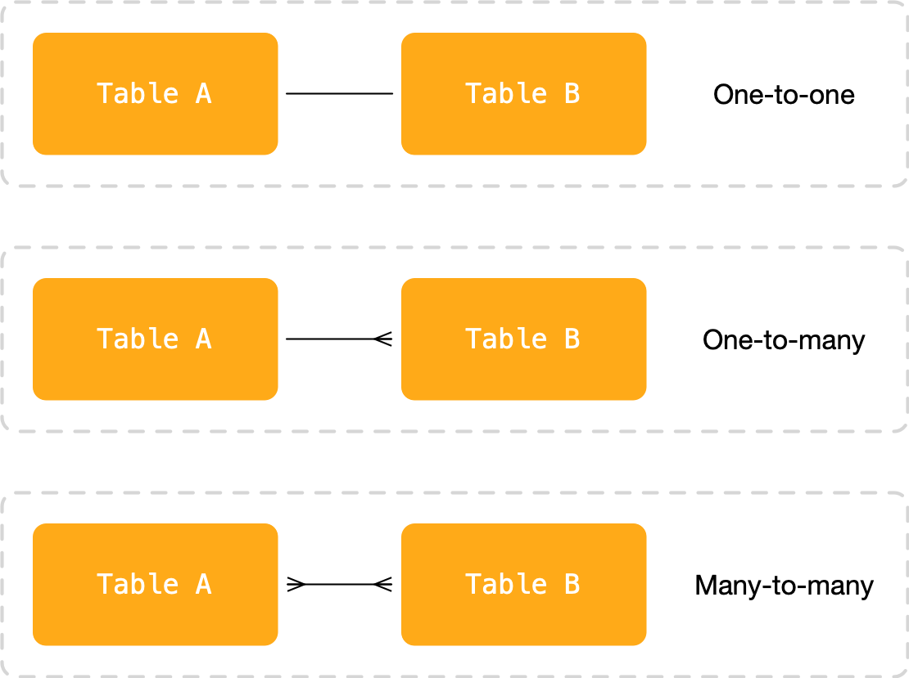
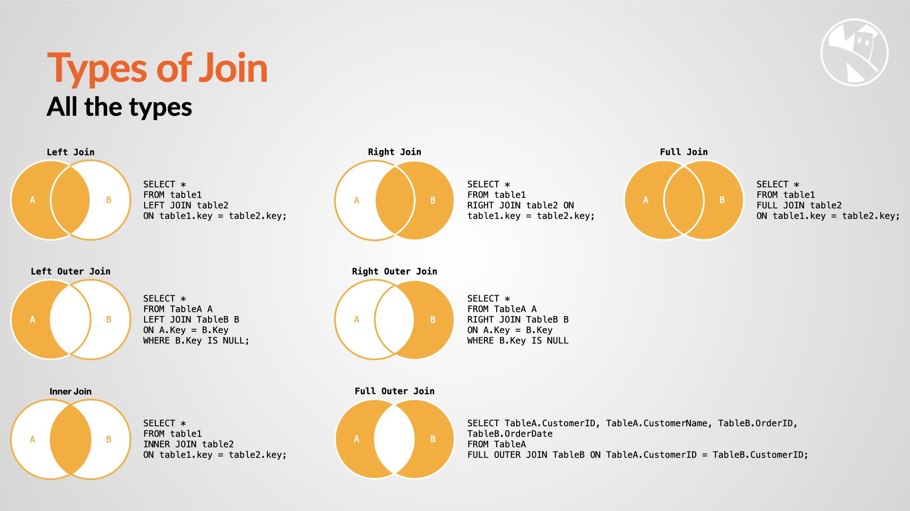

Module 6 focuses on more advanced querying techniques in SQLite, including working with multiple tables and performing joins. You will learn how to retrieve data from multiple tables, establish relationships, and use join operations to combine data.

### Working with Multiple Tables

Real-world databases often involve multiple tables that are related to each other. To retrieve meaningful data, we need to understand how to work with these tables collectively.

#### Relationships Between Tables

Tables can be related to each other through common attributes or columns. Common types of relationships include:

- **One-to-One**: Each record in one table is associated with exactly one record in another table.
- **One-to-Many**: Each record in one table is associated with one or more records in another table.
- **Many-to-Many**: Multiple records in one table are associated with multiple records in another table, creating a junction table to represent the relationship.

Understanding these relationships allows us to retrieve related data effectively.

{:class="img-fluid w-100"}

### Joining Tables

To combine data from multiple tables, we use SQL join operations. SQLite supports inner joins and left outer joins, and since version 3.39 (2022) also right and full outer joins. Check your version with `print(sqlite3.sqlite_version)`.

The examples below use three related tables. Run this first to create them, in a new database file so it doesn't clash with the earlier `books` table:

```python
import sqlite3

connection = sqlite3.connect('library.db')
with connection:
    connection.executescript('''
        CREATE TABLE IF NOT EXISTS authors (id INTEGER PRIMARY KEY, name TEXT);
        CREATE TABLE IF NOT EXISTS genres (id INTEGER PRIMARY KEY, genre_name TEXT);
        CREATE TABLE IF NOT EXISTS books (
            id INTEGER PRIMARY KEY, title TEXT, year INTEGER, price REAL,
            author_id INTEGER REFERENCES authors(id),
            genre_id INTEGER REFERENCES genres(id)
        );
        DELETE FROM books; DELETE FROM authors; DELETE FROM genres;
        INSERT INTO authors VALUES (1, 'Andy Weir'), (2, 'Frank Herbert'), (3, 'Ada Lovelace');
        INSERT INTO genres VALUES (1, 'Science fiction'), (2, 'Non-fiction');
        INSERT INTO books VALUES
            (1, 'The Martian', 2011, 9.99, 1, 1),
            (2, 'Project Hail Mary', 2021, 12.99, 1, 1),
            (3, 'Dune', 1965, 8.99, 2, 1),
            (4, 'Mystery Book', 2005, 5.99, NULL, 2);
    ''')
```

`executescript()` runs several SQL statements in one go. Notice that *Mystery Book* has no author, and Ada Lovelace has no books: that will matter for the joins.

{:class="img-fluid w-100"}

---

#### Inner Join

The inner join returns only the records that have matching values in both tables being joined.

```python
# Inner join example
query = '''
    SELECT books.title, authors.name
    FROM books
    INNER JOIN authors ON books.author_id = authors.id
'''
result = connection.execute(query)
data = result.fetchall()
```

In this example, we join the "books" and "authors" tables, matching each book's `author_id` to an author's `id`, and retrieve the book titles along with the author names. *Mystery Book* is left out, because it has no matching author.

#### Outer Join

Outer joins return all records from one table and the matching records from the other table. If no match is found, NULL values are filled in for the missing data.

```python
# Left outer join example
query = '''
    SELECT books.title, authors.name
    FROM books
    LEFT OUTER JOIN authors ON books.author_id = authors.id
'''
result = connection.execute(query)
data = result.fetchall()
```

In this example, we perform a left outer join between the "books" and "authors" tables, retrieving all books and the corresponding author names. *Mystery Book* is included this time, with `None` (SQL's `NULL`) for the author name.

### Joining Multiple Tables

We can join multiple tables together to retrieve data across related tables.

```python
# Joining multiple tables example
query = '''
    SELECT books.title, authors.name, genres.genre_name
    FROM books
    INNER JOIN authors ON books.author_id = authors.id
    INNER JOIN genres ON books.genre_id = genres.id
'''
result = connection.execute(query)
data = result.fetchall()
```

In this example, we join the "books," "authors," and "genres" tables, retrieving book titles along with author names and genre names.

### Aliasing Tables

To make SQL queries more readable, we can use table aliases to provide shorthand names for tables.

```python
# Using table aliases example
query = '''
    SELECT b.title, a.name
    FROM books AS b
    INNER JOIN authors AS a ON b.author_id = a.id
'''
result = connection.execute(query)
data = result.fetchall()
```

In this example, we use the aliases "b" and "a" for the "books" and "authors" tables, respectively, to simplify the query.

By understanding how to work with multiple tables and perform joins, you will be able to retrieve and combine data from various sources, providing more comprehensive insights from your databases.

---

## Try it yourself

Write a query that lists every author and how many books they have, including Ada Lovelace with 0. Hint: start `FROM authors` and use a `LEFT JOIN` to books, then look ahead to `GROUP BY` in the next module.


? A book has no matching author. Which join still includes it?
- [ ] `INNER JOIN` from books to authors
- [x] `LEFT JOIN` from books to authors
> A left join keeps every row from the left table, filling in NULL where there's no match.

? What does `FROM books AS b` do?
- [ ] Creates a copy of the table called b
- [x] Gives the table a short alias to use in the rest of the query
- [ ] Renames the table permanently
> Aliases only last for that query.


---
