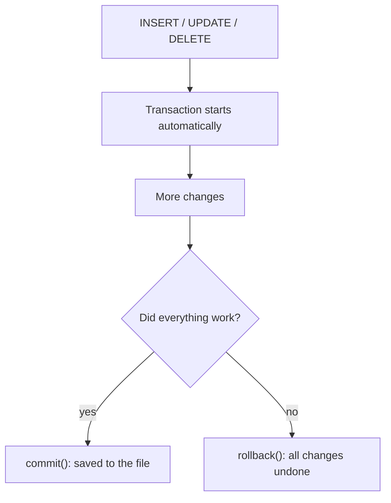

{:class="cover"}

---

By the end of this lesson you will be able to make a group of changes all-or-nothing with transactions, and catch SQLite errors in Python.

Module 8 covers the important topics of database transactions and error handling in SQLite. You will learn how to work with transactions to ensure data integrity and handle errors effectively in your Python code.

### Understanding Database Transactions

A database transaction is a logical unit of work that consists of one or more database operations. Transactions ensure that a group of database operations are executed as a single, atomic unit. If any part of the transaction fails, all changes made within the transaction can be rolled back.

The classic example is moving money between two bank accounts: taking it out of one and adding it to the other must either both happen, or neither.

#### ACID Properties

Transactions in databases follow the ACID properties:

- **Atomicity**: Transactions are indivisible and treated as a single unit. Either all changes are applied, or none of them are.
- **Consistency**: Transactions bring the database from one consistent state to another. All data modifications within a transaction must adhere to defined rules and constraints.
- **Isolation**: Transactions occur independently of each other. The changes made within a transaction are isolated from other concurrent transactions until the changes are committed.
- **Durability**: Once a transaction is committed, its changes are permanent and survive any subsequent system failures.

---



### How Python's sqlite3 handles transactions

SQLite itself uses the SQL statements `BEGIN`, `COMMIT` and `ROLLBACK`. Python's `sqlite3` module manages these for you:

- When you run an `INSERT`, `UPDATE` or `DELETE`, the module quietly starts a transaction
- Your changes are only saved when you call `connection.commit()`
- `connection.rollback()` throws away everything since the last commit

```python
import sqlite3

connection = sqlite3.connect('bank.db')
with connection:
    connection.execute("CREATE TABLE IF NOT EXISTS accounts (name TEXT PRIMARY KEY, balance REAL CHECK (balance >= 0))")
    connection.execute("INSERT OR REPLACE INTO accounts VALUES ('alice', 100), ('bob', 50)")

connection.execute("UPDATE accounts SET balance = balance - 30 WHERE name = 'alice'")
connection.execute("UPDATE accounts SET balance = balance + 30 WHERE name = 'bob'")
connection.commit()      # save both changes together
```

> ## Don't send BEGIN yourself
>
> Because the module starts transactions automatically, running `connection.execute("BEGIN")` yourself often fails with `cannot start a transaction within a transaction`. Use `commit()`, `rollback()` or a `with` block instead.

---

### The `with` block: commit or roll back automatically

The neatest way to make a group of changes all-or-nothing is a `with connection:` block. If everything works, it commits. If an exception is raised, it rolls back:

```python
def transfer(connection, sender, receiver, amount):
    try:
        with connection:
            connection.execute("UPDATE accounts SET balance = balance + ? WHERE name = ?", (amount, receiver))
            connection.execute("UPDATE accounts SET balance = balance - ? WHERE name = ?", (amount, sender))
        print("Transfer complete")
    except sqlite3.IntegrityError:
        print("Transfer cancelled: not enough money")

transfer(connection, 'bob', 'alice', 500)
print(connection.execute("SELECT * FROM accounts").fetchall())
```

Bob doesn't have 500, so the second `UPDATE` breaks the `CHECK (balance >= 0)` constraint. The `with` block rolls back, and Alice doesn't get money that never left Bob's account. This prints `Transfer cancelled: not enough money`, and the balances stay as they were. Try `transfer(connection, 'bob', 'alice', 20)` and it prints `Transfer complete`.

---

### Error Handling in SQLite

When working with databases, it's crucial to handle potential errors gracefully. The `sqlite3` module raises exceptions you can catch:

Exception | When it happens
---|---
`sqlite3.IntegrityError` | A constraint is broken, such as `UNIQUE`, `NOT NULL`, `CHECK` or a foreign key
`sqlite3.OperationalError` | Something's wrong with the query or the database, such as a missing table or a locked file
`sqlite3.Error` | The parent of all of them, so catching it catches every SQLite error
{:class="table table-single"}

```python
try:
    connection.execute("SELECT * FROM missing_table")
except sqlite3.OperationalError as e:
    print(f"Query failed: {e}")
except sqlite3.Error as e:
    print(f"An error occurred: {e}")
finally:
    connection.close()
```

The `finally` block makes sure the connection is closed whatever happens.

> ## Python 3.12 and later
>
> Python 3.12 added an `autocommit` option to `sqlite3.connect()` for finer control over transactions. The default behaviour described here still works in every version.

By understanding database transactions and error handling in SQLite, you will have the knowledge to manage data changes effectively, maintain data integrity, and handle errors in your Python code.

## Try it Yourself

1. Run the bank example, then call `transfer()` with an amount Bob can afford, and print both balances.
2. Make a transfer fail on purpose, and check that Alice's balance did not change.
3. Add a `log` table and insert a row into it inside the same `with` block as the transfer. Cancel a transfer and check the log row was rolled back too.
4. Challenge: catch `sqlite3.IntegrityError` for a failed transfer and `sqlite3.OperationalError` for a missing table, with a different message for each.

## Common Issues

- **Problem**: Your changes are missing from the file after the program ends.
- **Solution**: Call `commit()`, or wrap the changes in `with connection:`.
- **Why**: Until you commit, the changes live in an open transaction.

- **Problem**: `sqlite3.OperationalError: cannot start a transaction within a transaction`.
- **Solution**: Remove your own `execute("BEGIN")` and let the module manage transactions.
- **Why**: The module has already started one for you as soon as you ran an `UPDATE`.

- **Problem**: `sqlite3.OperationalError: database is locked`.
- **Solution**: Commit or close the other connection that has unsaved changes, then try again.
- **Why**: Only one connection can write at a time, and an open transaction holds the lock.

- **Problem**: `sqlite3.ProgrammingError: Cannot operate on a closed database.`
- **Solution**: Don't use a connection after `close()`. Open a new one.
- **Why**: A closed connection can't run any more SQL.

> **Teachers**: SQLite on a network drive or a synced folder (a school share, a cloud-synced folder) can give `database is locked` errors when several learners open the same file. Keep each learner's `.db` file on the local disk of their own machine.

---

## Check your understanding


? What does a `with connection:` block do if an error happens inside it?
- [ ] Commits whatever worked
- [x] Rolls back all the changes made in the block
- [ ] Closes the connection
> That's what makes the changes all-or-nothing. The connection stays open.

? Which exception is raised when a `UNIQUE` constraint is broken?
- [x] `sqlite3.IntegrityError`
- [ ] `sqlite3.OperationalError`
- [ ] `ValueError`
> Integrity errors are about the data breaking the rules you set on the table.

? In the bank example, the transfer fails halfway. What state is the database in?
- [ ] Alice has the money and Bob still has it too
- [x] Unchanged, because the `with` block rolled everything back
- [ ] Half the transfer is saved
> That's atomicity: all of the changes happen, or none of them do.

? Why should you avoid running `BEGIN` yourself with Python's `sqlite3`?
- [x] The module already starts transactions for you, so it can fail with "cannot start a transaction within a transaction"
- [ ] `BEGIN` isn't valid SQL
- [ ] It deletes the data
> Use `commit()`, `rollback()` or a `with` block instead.


---
